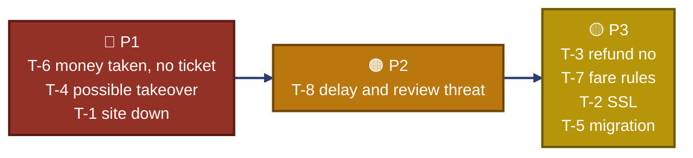
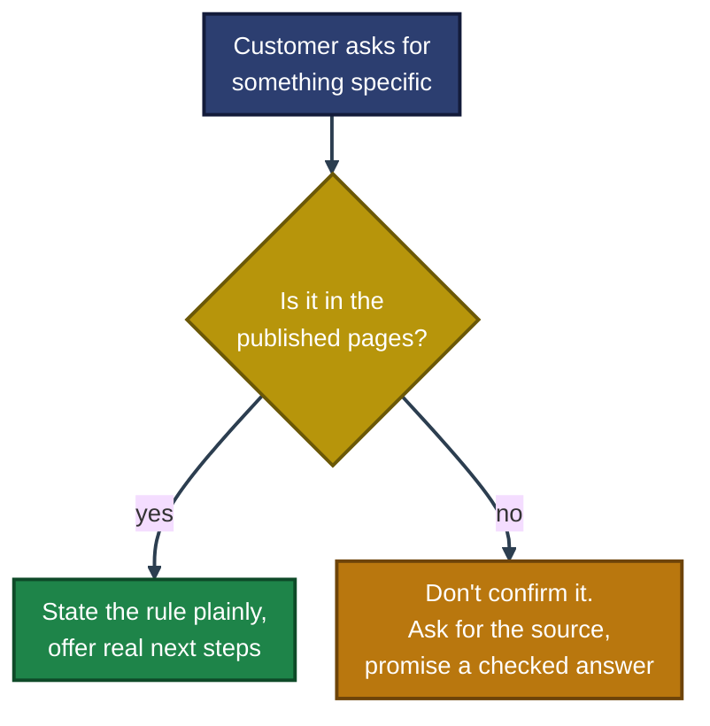

<div align="center">

# 🎧 Multi-Brand Support Queue Assessment

**TechAbout Customer Support — PKHosting + Travel.pk**

One agent, two queues, eight tickets, one Friday shift


This document is based on the published pages. I ordered the queue, wrote the replies and internal notes, and marked everything I could not confirm. No refund rule, guarantee or fee in this document is invented. Where a page was silent, I wrote a question instead.

</div>

---

## 📑 Table of Contents

1. [At a Glance](#at-a-glance)
2. [Assessment Background](#assessment-background)
3. [Environment](#environment)
4. [Sources Used](#sources-used)
5. [Order of Work](#order-of-work)
6. [Key Decisions](#key-decisions)
7. [Strategic Tradeoffs](#strategic-tradeoffs)
8. [Verification & Testing](#verification-testing)
9. [Scope & Limitations](#scope-limitations)
10. [What I Learned](#what-i-learned)
11. [What I Would Improve](#what-i-would-improve)
12. [Skills Demonstrated](#skills-demonstrated)
13. [Repo Structure](#repo-structure)

---

<a id="at-a-glance"></a>
## 📊 At a Glance

| 🎫 Tickets Triaged | ✉️ Replies | 🧪 Diagnostic Notes | 🚨 Escalation | 🧩 Macros | 📄 Pages |
|:---:|:---:|:---:|:---:|:---:|:---:|
| **8** | **7** (T-6 twice) | **2** | **1** | **2** | **6** |

---

<a id="assessment-background"></a>
## 📖 Assessment Background

One agent covers both queues on a shift. The tickets are invented, so no real customer was contacted and nothing here reaches a live operation.

- **Part A — Triage:** priority, first-response target, owner and a one-line reason for all 8 tickets.
- **Part B — Replies:** T-1, T-3, T-4, T-6 (Roman Urdu and English), T-7 and T-8, each under 200 words and ending in a next step and a time.
- **Part C — Diagnostics:** notes for T-2 and T-5, not replies.
- **Part D — Escalation:** a 150-word note for T-4, including what I did not do.
- **Part E — Macros:** one per brand, with placeholders and "do not use when".
- **Parts F and G — Gaps and clarity audit:** five questions the pages don't answer, and three real ambiguities with proposed wording.

> [!NOTE]
> This is a written simulation. Nothing was run against a real system. Items I could not confirm are marked 📝 or listed in [Scope & Limitations](#scope-limitations).

---

<a id="environment"></a>
## 🖧 Environment

| Item | Value |
|---|---|
| **Deliverable** | `Malaika_Azhar_TechAbout_Customer_Support_Assessment_updated.pdf` (A4, 6 pages) |
| **Shift date used** | Friday, 6 November 2026 |
| **Tools** | Public web pages only. No credentials, private data or paid tools |
| **Time taken** | About 2 hours of active work, in short sessions through the day |
| **Languages** | English, and Roman Urdu for T-6 |

---

<a id="sources-used"></a>
## 🔎 Sources Used

| Source | What the document takes from it |
|---|---|
| pkhosting.com/refund (Aug 2026) | First-time shared/WordPress orders can be reviewed within 7 days of payment. Domains, SSL/add-ons, VPS/dedicated, setup and migration fees, taxes and gateway charges are non-refundable. Approved refunds return in 7-10 business days. No outage refund. |
| pkhosting.com homepage | Live chat/phone Mon-Fri 9am-6pm PKT. Backups are on the same server, best-effort, with no recovery-time SLA. Free migration is listed. Plans are 5, 25 and 50 GB. |
| travel.pk/refund-policy (v2.0, 10 Aug 2026) | The airline controls disruption options. A delay does not automatically create a refund. Promo fares can be non-refundable. |
| travel.pk Terms and Trust Centre | A payment receipt is not a ticket. Staff hours are Mon-Fri 10am-7pm PKT. Escalation goes to legal@travel.pk with the ticket reference. |

> [!IMPORTANT]
> A **"Best Price Guarantee"** and an **"on-time promise"** do not appear in the terms, refund policy, homepage or Trust Centre. I treat both customer claims (T-7, T-8) as unverified and do not confirm them. The Help Center and the PKHosting Terms and backup-policy pages were not reviewed, so they should be checked before sending.

---

<a id="order-of-work"></a>
## ⏱️ Order of Work

**T-6 → T-4 → T-1 → T-8 → T-3 → T-7 → T-2 → T-5**



| Ticket | Brand | Priority | First response |
|---|---|:---:|:---:|
| T-6 JazzCash paid, no e-ticket | Travel.pk | 🔴 P1 | 10 min |
| T-4 Gmail "new IT manager" | PKHosting | 🔴 P1 | 15 min |
| T-1 Site down, wants refund | PKHosting | 🔴 P1 | 15 min |
| T-8 3h10m delay, review threat | Travel.pk | 🟠 P2 | 30 min |
| T-3 Day 19, wants refund today | PKHosting | 🟡 P3 | 2 hrs |
| T-7 Promo fare, free date change | Travel.pk | 🟡 P3 | 2 hrs |
| T-2 "Not secure" after CDN | PKHosting | 🟡 P3 | 4 hrs |
| T-5 12 GB WooCommerce migration | PKHosting | 🟡 P3 | 4 hrs |

**Why Friday matters:** Travel.pk's published staffed hours are Mon-Fri 10am-7pm PKT, and the T-6 flight is on Saturday. After 7pm there is nobody on shift, so T-6 goes first and I promise an answer before 7pm.

---

<a id="key-decisions"></a>
## 🧭 Key Decisions



- **T-4 is the ticket that isn't what it appears.** A Gmail sender, a "new IT manager", an offered fee and no contact with the old developer is the usual shape of an account takeover. I changed nothing, confirmed nothing, and named the only legitimate route: confirmation from the registered email, or signed authorisation with ID. The escalation note lists what I did not do.
- **T-7 and T-8 rest on guarantees that don't appear on the published pages.** I don't confirm them. I ask for a screenshot, say what the published policy says, and promise a written fare-rules answer (T-7) or the airline's options (T-8).
- **T-3 is a clear no.** Day 19 is outside the 7-day window, and domain and setup fees are non-refundable. I still offer real next steps: cancel before renewal, fix any fault, billing review.
- **T-1 promises no refund.** The policy has no outage refund. I note the request for my manager and come back once the site is stable.
- **T-6 is bilingual.** The Roman Urdu and English versions carry the same facts: payment and ticket are different steps, don't pay again, and an update within 30 minutes.
- **Time commitments are things I control.** I never promise an outcome that depends on someone else, such as the airline's answer in T-8.

---

<a id="strategic-tradeoffs"></a>
## ⚖️ Strategic Tradeoffs

| Decision | Tradeoff |
|---|---|
| T-6 before T-4 | A safe reply to T-4 is quick and nothing is lost by a short wait, but a wrong action there is the real damage. T-6 has a hard 7pm deadline. |
| T-3 is P3, not P4 | The answer is no, but an unanswered refusal can become a chargeback, and the policy says chargebacks may lead to suspension. |
| Holding the line in T-8 | I don't trade a refund for a review. I say the customer is free to review and explain what a delay does and doesn't entitle them to. |
| Honesty vs warmth | I say "I can't promise" in the first reply rather than raise hope and walk it back. |
| Scope | Diagnostics only for T-2 and T-5, as the brief asked. I cut long shell-command lists because the pages don't say what stack the servers run. |

---

<a id="verification-testing"></a>
## 🧪 Verification & Testing

| Check | Result |
|---|---|
| Reply word limits | ✅ All under 200 words (longest about 197) |
| Escalation note length | ✅ About 150 words |
| Facts against sources | ✅ Each claim in the replies matches the published page it came from |
| Safe asks only | ✅ Diagnostics never ask for passwords, API tokens, private keys, `wp-config.php`, database dumps or gateway keys |
| Roman Urdu (T-6) | ⚠️ Written in simple, respectful Urdu and consistent with the English version, but **not yet checked by a native speaker** |
| Run against real systems | ❌ Not applicable. The T-2 commands are read-only examples for a sysadmin |

---

<a id="scope-limitations"></a>
## 🚧 Scope & Limitations

- **Written simulation only:** Nothing was deployed or run. No customer replied to anything.
- **Pages not reviewed:** the Help Center and the PKHosting Terms and backup-policy pages. T-1, T-7 and T-8 should be re-checked against them.
- **Plan type assumed:** I assumed Professional is a shared plan under the refund page. It is flagged in the T-3 note to check before sending.
- **"Eid in four days":** this does not match the real calendar for 6 Nov 2026. I treated it as the customer's stated deadline and never repeat the date back.
- **Clarity audit wording:** section G gives my wording for three ambiguities. It is proposed text and needs product-owner sign-off.
- **Native review pending:** the T-6 Roman Urdu reply.

These gaps are listed instead of hidden, so the document shows what was actually done.

---

<a id="what-i-learned"></a>
## 🧠 What I Learned

- **Check the source before you promise.** Two of the eight tickets depended on guarantees that do not appear on any published page.
- **Say no early and kindly.** A clear refusal with real next steps keeps the customer better than a vague "maybe".
- **Time matters as much as policy.** The Friday 7pm cutoff changed the whole order of work.
- **Security tickets look polite.** The T-4 request was calm and offered money. That is the pattern to slow down on.
- **Only promise what you control.** "I'll update you in 30 minutes" is honest. "The airline will refund you" is not.
- **Write down what was not proven.** A document that lists its gaps is easier to trust.

---

<a id="what-i-would-improve"></a>
## 🔧 What I Would Improve

- Review the Help Center and the remaining PKHosting pages, then re-check T-1, T-7 and T-8.
- Have a native Urdu speaker review the T-6 reply.
- Add an out-of-hours escalation path for outages and ticketing emergencies (see section F, questions 2 and 4).
- Turn the two macros into a small tested library covering other common cases (double charge, domain transfer, SSL).

---

<a id="skills-demonstrated"></a>
## 🛠️ Skills Demonstrated

- Triage under a hard deadline across two brands
- Reading and applying published refund and fare policies accurately
- Declining a request clearly while keeping the customer
- Spotting a likely account takeover and writing a clean escalation
- Writing the same message in Roman Urdu and English
- Writing safe diagnostic notes that never ask for secrets
- Separating what is proven from what is assumed

---

<a id="repo-structure"></a>
## 📁 Repo Structure

```text
support-assessment/
|-- README.md
`-- Malaika_Azhar_TechAbout_Customer_Support_Assessment_updated.pdf
```

<div align="center">

🎧 **[PKHosting](https://www.pkhosting.com/refund/)** · ✈️ **[Travel.pk Refund Policy](https://travel.pk/refund-policy/)** · 🛡️ **[Travel.pk Trust Centre](https://travel.pk/trust/)** · 🧭 **[Order of Work](#order-of-work)**

</div>
